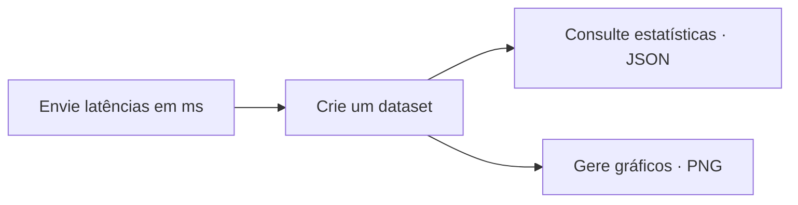

# API Performance Monitor


**Transforme medições de latência em estatísticas e gráficos.**
Armazene tempos de resposta em milissegundos, explore sua distribuição e
identifique possíveis valores atípicos pela API.

[**Experimentar no Swagger ↗**](https://api-performance-monitor-0vke.onrender.com/docs)
· [Executar localmente](#executar-localmente)
· [Documentação](docs/README.md)

> Em desenvolvimento: a versão atual analisa datasets enviados pelo usuário.
> A coleta automática de APIs externas está no [plano da v1](docs/plano-v1.md).

## Como funciona



| Organize | Analise | Visualize |
| --- | --- | --- |
| Crie datasets e adicione ou remova medições. | Consulte média, percentis, dispersão e outliers. | Gere histograma, boxplot, curva acumulada, frequência e gráfico por ordem da medição. |

## Experimente em três passos

No [Swagger UI](https://api-performance-monitor-0vke.onrender.com/docs), execute:

**1. Crie um dataset** com `POST /datasets`:

```json
{"latency_ms": [100, 100, 110, 120, 130, 450]}
```

**2. Consulte as estatísticas** usando o `id` recebido como `dataset_id`:

| Requisição | Resultado para o exemplo |
| --- | --- |
| `GET /datasets/{dataset_id}/statistics/mean` | Média de aproximadamente **168,33 ms**. |
| `GET /datasets/{dataset_id}/statistics/percentile?percent=95` | p95 de **370 ms**. |
| `GET /datasets/{dataset_id}/statistics/outliers` | **450 ms** como possível valor atípico. |

**3. Gere um gráfico** com `GET /datasets/{dataset_id}/charts/histogram?bins=6`:


*PNG gerado pelo próprio projeto com os dados ilustrativos acima.
[Como reproduzir a imagem](docs/domain-guide.md#reproduzir-a-imagem-do-readme).*

## Executar localmente

Com Docker e Compose disponíveis, na raiz de uma cópia recém-clonada:

```bash
cp .env.example .env
docker compose up -d --build
```

Abra <http://localhost:8000/docs> e siga os mesmos três passos.
O Compose aguarda o banco e a imagem aplica as migrações antes de iniciar a API.
Se já tiver um `.env`, mantenha sua configuração.

[Configuração do banco e comandos Docker](docs/database-and-migrations.md)
· [Desenvolvimento com uv e testes](docs/architecture.md#desenvolvimento-e-testes)

## Explore a documentação

| Quero… | Guia |
| --- | --- |
| Consultar rotas, parâmetros, erros e limites | [Referência da API](docs/api-reference.md) |
| Entender as camadas e executar os testes | [Arquitetura e desenvolvimento](docs/architecture.md) |
| Estudar os cálculos e gerar gráficos em Python | [Domínio e visualizações](docs/domain-guide.md) |
| Configurar PostgreSQL e migrações | [Banco de dados](docs/database-and-migrations.md) |
| Entender o deploy e o CI | [Deploy no Render](docs/render-deploy.md) |
| Conhecer as próximas etapas | [Plano da v1](docs/plano-v1.md) |
