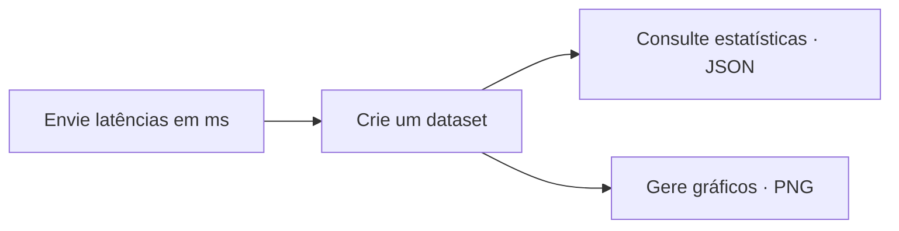
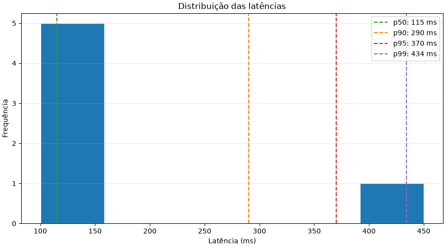
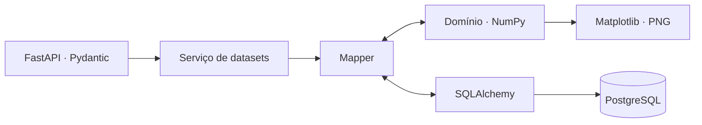

# API Performance Monitor


**Transforme medições de latência em estatísticas e gráficos.**
Armazene tempos de resposta em milissegundos, explore sua distribuição e
identifique possíveis valores atípicos pela API.

[**Experimentar no Swagger ↗**](https://api-performance-monitor-0vke.onrender.com/docs)
· [Executar localmente](#executar-localmente)
· [Documentação](docs/README.md)

> Em desenvolvimento: a versão atual analisa datasets enviados pelo usuário.
> A coleta automática de APIs externas está no [plano da v1](docs/plano-v1.md).

## Como funciona



| Organize | Analise | Visualize |
| --- | --- | --- |
| Crie datasets e adicione ou remova medições. | Consulte média, percentis, dispersão e outliers. | Gere histograma, boxplot, curva acumulada, frequência e gráfico por ordem da medição. |

## O que a API já entrega

- **Datasets persistidos:** criação, consulta, listagem com paginação e exclusão
  de conjuntos de latências em PostgreSQL.
- **Medições individuais:** inclusão, consulta, filtro por valor e remoção por ID,
  preservando a ordem de inserção e impedindo que um dataset fique vazio.
- **Estatística descritiva:** média, mediana, moda, quartis, percentis, variância,
  desvio padrão e identificação de possíveis outliers pelo intervalo interquartil.
- **Análise por limite:** contagem e proporção de medições acima de uma latência
  de referência, além da contagem de valores menores ou iguais ao limite.
- **Cinco visualizações em PNG:** histograma, boxplot, distribuição acumulada,
  frequência e latência por ordem da medição. Esse último gráfico usa a posição
  da amostra, sem representar horários reais.
- **Validação e erros consistentes:** rejeição de latências negativas, booleanos
  e valores não finitos, com respostas JSON documentadas no OpenAPI.

## Experimente em três passos

No [Swagger UI](https://api-performance-monitor-0vke.onrender.com/docs), execute:

**1. Crie um dataset** com `POST /datasets`:

```json
{"latency_ms": [100, 100, 110, 120, 130, 450]}
```

A resposta `201 Created` inclui o `id` e as medições salvas. O cabeçalho
`Location` aponta para o recurso criado; cada consulta seguinte usa esse ID.

**2. Consulte as estatísticas** usando o `id` recebido como `dataset_id`:

| Requisição | Resultado para o exemplo |
| --- | --- |
| `GET /datasets/{dataset_id}/statistics/mean` | Média de aproximadamente **168,33 ms**. |
| `GET /datasets/{dataset_id}/statistics/percentile?percent=95` | p95 de **370 ms**. |
| `GET /datasets/{dataset_id}/statistics/outliers` | **450 ms** como possível valor atípico. |

**3. Gere um gráfico** com `GET /datasets/{dataset_id}/charts/histogram?bins=6`:



*PNG gerado pelo próprio projeto com os dados ilustrativos acima.
[Como reproduzir a imagem](docs/domain-guide.md#reproduzir-a-imagem-do-readme).*

## Principais operações

| Recurso | Requisição | Uso |
| --- | --- | --- |
| Dataset | `POST /datasets` | Salvar um conjunto de medições. |
| Listagem | `GET /datasets?limit=50&offset=0` | Percorrer datasets em páginas. |
| Consulta | `GET /datasets/{dataset_id}` | Recuperar as latências de um dataset. |
| Medição | `POST /datasets/{dataset_id}/measurements` | Adicionar `{"latency_ms": 130}` ao conjunto. |
| Filtro | `GET /datasets/{dataset_id}/measurements?latency_ms=100` | Encontrar as ocorrências de um valor e seus IDs. |
| Percentil | `GET /datasets/{dataset_id}/statistics/percentile?percent=95` | Consultar o p95 em milissegundos. |
| Gráfico | `GET /datasets/{dataset_id}/charts/boxplot` | Receber a visualização diretamente em PNG. |

As exclusões usam `DELETE` no endereço do dataset ou da medição e retornam
`204 No Content`. Recursos ausentes retornam `404`; remover a última medição
retorna `409`; entradas inválidas retornam `422`, com o formato `{"detail": "..."}`.

Os gráficos aceitam até **10.000 medições por dataset**; o de frequência aceita
até **200 latências distintas**. A [referência da API](docs/api-reference.md)
reúne todas as rotas, os parâmetros e os limites.

## Arquitetura e tecnologias



As regras de validação e os cálculos ficam no domínio, sem depender do FastAPI
ou do SQLAlchemy. O serviço coordena as operações, e o mapper converte os
schemas HTTP, os objetos de domínio e os modelos persistidos.

| Responsabilidade | Ferramentas |
| --- | --- |
| API e contratos HTTP | FastAPI e Pydantic |
| Estatística e visualização | NumPy e Matplotlib |
| Persistência e migrações | PostgreSQL 17, SQLAlchemy e Alembic |
| Ambiente e validação | uv, Docker Compose, pytest e GitHub Actions |

## Executar localmente

Com Docker e Compose disponíveis, na raiz de uma cópia recém-clonada:

```bash
cp .env.example .env
docker compose up -d --build
```

Abra <http://localhost:8000/docs> e siga os mesmos três passos.
O Compose aguarda o banco e a imagem aplica as migrações antes de iniciar a API.
Se já tiver um `.env`, mantenha sua configuração.

O PostgreSQL é publicado em `127.0.0.1:55432`; a API usa `db:5432` entre
containers. A porta do host pode ser alterada por `POSTGRES_HOST_PORT` no `.env`.

Para acompanhar a aplicação ou executar a suíte local:

```bash
docker compose logs -f api
```

```bash
uv sync --locked
uv run --locked pytest -q
```

`docker compose down` encerra os containers e preserva o volume do banco.
O deploy no Render usa a imagem Docker e aplica migrações na inicialização;
o CI verifica testes e o fluxo de deploy com PostgreSQL descartável.

[Configuração do banco e comandos Docker](docs/database-and-migrations.md)
· [Desenvolvimento com uv e testes](docs/architecture.md#desenvolvimento-e-testes)

## Explore a documentação

| Quero… | Guia |
| --- | --- |
| Consultar rotas, parâmetros, erros e limites | [Referência da API](docs/api-reference.md) |
| Entender as camadas e executar os testes | [Arquitetura e desenvolvimento](docs/architecture.md) |
| Estudar os cálculos e gerar gráficos em Python | [Domínio e visualizações](docs/domain-guide.md) |
| Configurar PostgreSQL e migrações | [Banco de dados](docs/database-and-migrations.md) |
| Entender o deploy e o CI | [Deploy no Render](docs/render-deploy.md) |
| Conhecer as próximas etapas | [Plano da v1](docs/plano-v1.md) |
