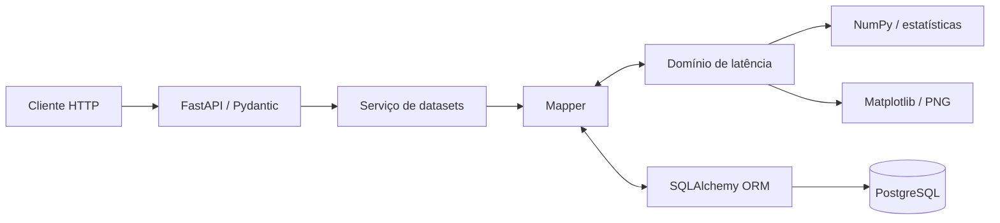

# Arquitetura e desenvolvimento

[Voltar ao índice da documentação](README.md)

## Fluxo entre as camadas



As regras matemáticas permanecem no domínio e não dependem do FastAPI nem do
SQLAlchemy. O serviço coordena as operações das rotas, enquanto o mapper faz a
conversão explícita entre schemas HTTP, objetos de domínio e modelos
persistidos.

## Tecnologias

| Área | Tecnologia |
| --- | --- |
| API e contratos | FastAPI e Pydantic |
| Domínio e cálculos | Python e NumPy |
| Persistência | SQLAlchemy e PostgreSQL 17 |
| Migrações | Alembic |
| Visualização | Matplotlib |
| Ambiente | uv e Docker Compose |

## Estrutura do projeto

```text
.
├── alembic/                         # Migrações do banco
├── docs/                            # Guias de estudo e desenvolvimento
├── src/api_performance_monitor/
│   ├── domain/                      # Regras e cálculos de latência
│   ├── errors/                      # Tradução de erros para HTTP
│   ├── mapper/                      # Conversões entre camadas
│   ├── models/                      # Modelos SQLAlchemy
│   ├── roots/                       # Rotas FastAPI
│   ├── schemas/                     # Contratos Pydantic
│   ├── services/                    # Orquestração entre API e persistência
│   └── visualization/               # Gráficos e exportação PNG
├── compose.yaml
├── Dockerfile
└── main.py                          # Configuração da aplicação
```

## Desenvolvimento e testes

Na raiz do repositório, com Python 3.13 ou superior e uv disponíveis:

```bash
uv sync --locked
uv run --locked pytest -q
```

Os testes das rotas substituem a conexão da aplicação por SQLite em memória;
essa suíte não depende do PostgreSQL de desenvolvimento. A validação da imagem
e das migrações em PostgreSQL descartável tem um roteiro separado no
[guia de deploy](render-deploy.md#reproduzir-a-validação-de-deploy-localmente).

Para executar a API no host com o banco do Compose, siga a
[configuração do banco](database-and-migrations.md#variáveis-de-ambiente) e use:

```bash
docker compose up -d db
POSTGRES_HOST=127.0.0.1 POSTGRES_PORT=55432 uv run --locked alembic upgrade head
POSTGRES_HOST=127.0.0.1 POSTGRES_PORT=55432 uv run --locked uvicorn main:app --reload
```

Se tiver alterado `POSTGRES_HOST_PORT`, substitua `55432` pela porta escolhida.
O Swagger fica disponível em <http://localhost:8000/docs>.

## Outros guias

- [Referência HTTP](api-reference.md): rotas, parâmetros, respostas e limites.
- [Domínio e visualizações](domain-guide.md): exemplos Python e regras matemáticas.
- [Banco e migrações](database-and-migrations.md): configuração, volumes e Alembic.
- [Deploy no Render](render-deploy.md): imagem Docker, CI e publicação.
